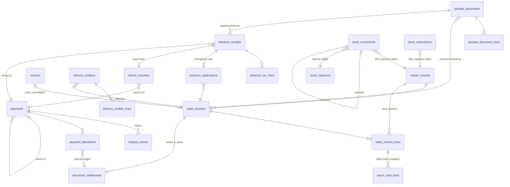

# Sales, stock and money tables v1

Owner: GPT 1 (#365). Consumers: the PostgreSQL repositories of `sales`, `inventory` and
`receivables` (#366), the concurrency work (#367), the runtime switch (#340), and the lanes that
later write `document_settlements` (purchasing, returns).
Builds on [`unit-of-work-v1`](./unit-of-work-v1.md) and
[`database-immutability-v1`](./database-immutability-v1.md).

**In plain words:** these are the tables a shop's bills, stock, payments, advances, challans and
quotations are kept in. The database itself refuses the mistakes that matter: stock below nothing,
a bill paid twice over, an issued bill edited, one shop's bill pointing at another shop's customer.
Our code checks these things too; the database checks them again, so one bug cannot break the books.

Migrations: `packages/sales/src/migrations.ts`, `packages/inventory/src/migrations.ts`,
`packages/receivables/src/migrations.ts`. Test: `packages/sales/test/sales-schema.integration.test.ts`.

## Tables

| Table | Holds | Replaces |
| --- | --- | --- |
| `sales_invoices`, `sales_invoice_lines` | A bill from draft to issued to cancelled, and its lines (goods and charges) | `InMemorySalesRepository` |
| `presale_documents`, `presale_document_lines` | Quotations and proforma invoices | `InMemoryPreSaleRepository` |
| `delivery_challans`, `delivery_challan_lines` | Delivery challans, their e-way bill and the bill that closed them | `InMemoryChallanRepository` |
| `stock_movements` | Every movement of stock, append-only | `InMemoryInventoryStore.movements` |
| `stock_balances` | What is on hand per item, godown and batch — the sum of the movements, kept by the database | (new) |
| `stock_reservations` | Stock held by unfinished bills | `InMemoryInventoryStore.reservations` |
| `payments`, `cheque_events`, `payment_allocations` | Money in and out, a cheque's history, and what each payment settled | `InMemoryPaymentRepository` |
| `document_settlements` | What one bill is worth and how much of it is paid | (new) |
| `advance_receipts`, `advance_tax_lines`, `advance_applications`, `refund_vouchers` | Receipt vouchers for advances (Rule 50), the bill that used them, and refund vouchers (Rule 51) | `InMemoryAdvanceRepository` |

## On every table

- `id uuid` primary key, `company_id uuid NOT NULL` with a foreign key, `created_at`, `updated_at`.
- **Forced row-level security** on `app.company_id` (the `return_notes` policy).
- **Foreign keys carry the company**: `(company_id, party_id) REFERENCES master_records(company_id, id)`.
  A row cannot point at another company's customer, item, godown, bill or ledger entry. For this,
  `branches`, `master_records` and `voucher` gain `UNIQUE (company_id, id)`.
- Money is `*_paise bigint`, quantity `*_micro bigint` with a `unit_code`, rates `*_bp` (1800 = 18%).
  Document dates are `date`; system times are `timestamptz`.
- A printed number is at most 16 characters (Rules 46(b), 50, 51, 55). All numbers come from the
  ledger's `ledger_sequence` counter, with the scope strings the services already use. There is no
  second counter.
- Numbered documents carry `origin` (`'server'`, or a device id) and `device_issued_at`, for
  offline billing (ADR 0012, built in #317). A device will have its own series, which is just
  another `ledger_sequence` scope, so nothing here changes when #317 lands.

## Rules the database enforces

| Rule | How |
| --- | --- |
| A draft never holds a number; an issued bill has its number, its ledger entry, its pricing and who issued it | `CHECK`s on `sales_invoices` |
| A cancellation names its reversal entry, who, when and why | `CHECK` |
| An issued document's figures, date, customer and lines never change, and it is never deleted. A bill may only go `FINAL → CANCELLED`; a quotation, proforma or challan only from `ISSUED` to closed or withdrawn | `platform_freeze_posted`, `platform_freeze_with_parent` (#368) |
| The lines of an issued document add up to its totals: line count, taxable value, and billed tax | `document_lines_add_up`, checked when the transaction ends |
| A quotation is closed by a sale, a proforma by its tax invoice | `CHECK` |
| A credit note takes back no more of a line than the bill sold, less earlier credit notes | `sales_return_within_original` on `return_note_lines`; it locks the bill's line first |
| **Stock never goes below nothing. There is no override** (owner's rule, #262) | `CHECK (on_hand_micro >= 0)` on `stock_balances` |
| A stock balance is the sum of its movements and nobody edits it | Only the trigger on `stock_movements` writes `stock_balances`. The application role cannot insert, update or delete a balance |
| A movement is final; it is undone once, by another movement, with a reason | freeze trigger, `UNIQUE (company_id, reverses_movement_id)`, `CHECK`s |
| A movement's direction belongs to its kind; one stock is counted in one unit | `CHECK`, trigger |
| A payment settles no more than itself; a bill is paid no more than its value | `CHECK`s on `payments.allocated_paise` and `document_settlements.allocated_paise`. Only the trigger on `payment_allocations` writes those two figures |
| A part payment never marks a bill paid | `document_settlements.status` is computed by the database from the figures |
| Money cannot be applied to a sales bill that was never issued | the allocation trigger |
| A released allocation stays released; a reversed payment stays reversed and says why | triggers, `CHECK` |
| A cheque's history is only ever added to | `cheque_events` is frozen |
| No GST on an advance for goods (Notification 66/2017) | `CHECK` |
| What a bill took of an advance plus what was refunded is never more than the advance | `advance_not_overused`, checked when the transaction ends |
| A retry lands once | `UNIQUE (company_id, idempotency_key)` on each document |

Refusals arrive as PostgreSQL errors: `23514` (a rule above), `23001` (a frozen record),
`23503` (wrong company or missing record), `23505` (duplicate number or retry), `42501` (the
application may not do that at all). Each named rule sets the `constraint` field of the error.

## What the repositories of #366 must do

- Write through `db.requireUnitOfWork(companyId).sql`; read through `db.tenantTransaction`.
- **Lines.** Write every computed line, including the freight and other-charge lines
  (`kind = 'CHARGE'`, `item_id` null, `charge_kind` set). Set `line_count`, the totals and
  `pricing` on the header from the calculator's answer. The whole of `InvoicePricing` goes in
  `pricing jsonb` so the document reads back exactly; the columns repeat the figures that lists,
  reports and checks need.
- **Branch.** The services use the branch id `'main'` when a person has no branch. Store that as
  `NULL` and read `NULL` back as `'main'`.
- **Discarding a draft, and replacing a draft's lines.** The application cannot `DELETE`. Call
  `SELECT sales_discard_draft($1, $2)` (`lines_only` true to replace lines, false to discard the
  bill). It returns false, and removes nothing, for an issued bill or another company's bill.
- **Stock.** Insert the movement; the balance moves itself. A refused movement
  (`constraint = 'stock_balances_never_negative'`) is "not enough stock". To decide what can be
  sold, lock the balance rows first (`SELECT … FROM stock_balances … ORDER BY item_id,
  warehouse_id, batch_id FOR UPDATE`) and subtract the `HELD` reservations whose `expires_at`
  has not passed. A hold lapses by the clock, so what is held is never stored as a figure.
- **Settlements.** When a sales bill is issued, insert its `document_settlements` row in the same
  unit of work (`value_paise` = the bill's value). When it is cancelled, set `cancelled = true`.
- **Allocations.** A payment's `allocations` are rows of `payment_allocations`. To drop one (a
  bounced cheque, a reversed payment), set `released_at`; never delete. Do not write
  `allocated_paise` anywhere; it is refused.
- **Cheques.** Append each step to `cheque_events` and set `payments.cheque_state` to the latest.

## Known limits

- **Returns of bills that are not in `sales_invoices`.** Until the running app is on PostgreSQL
  (#340), a bill may exist only in memory. The credit-note cap lets such a return through, and the
  returns service checks it as it does today.
- **`return_note_lines.item_id` is a `uuid` with a foreign key**, but a returned freight charge has
  the item id `charge:freight`. The returns repository (#366) must store that as it stores it in
  memory; this is an existing gap in the returns table, not one of these tables.
- **`document_settlements` holds sales bills only.** Purchase bills and credit and debit notes
  join from their own lanes. Until then an allocation against one of those is recorded and capped
  by the payment's amount, but not by the document's value.
- **Money refunded out of an unused receipt** (`payments.refund_of`) is capped by the service, not
  by a database figure.
- **Serial numbers** are kept on the movement as a list. "This serial is in stock" is still worked
  out by the inventory service from the movements.
- **Reserved stock can exceed stock on hand** as far as the database is concerned; the inventory
  service refuses a hold it cannot cover, under the lock described above.

## Changes to other contracts

- `database-immutability-v1` — the tables above join "What is frozen today". The application role
  still deletes from `user_branch_access` only.
- `inventory.v1`, `receivables.v1`, `sales.v1` — no change to commands, ports or errors. These
  tables store what the in-memory repositories store.
